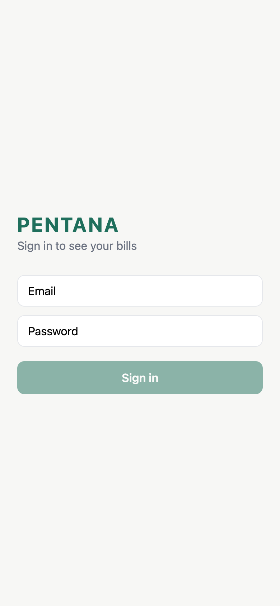
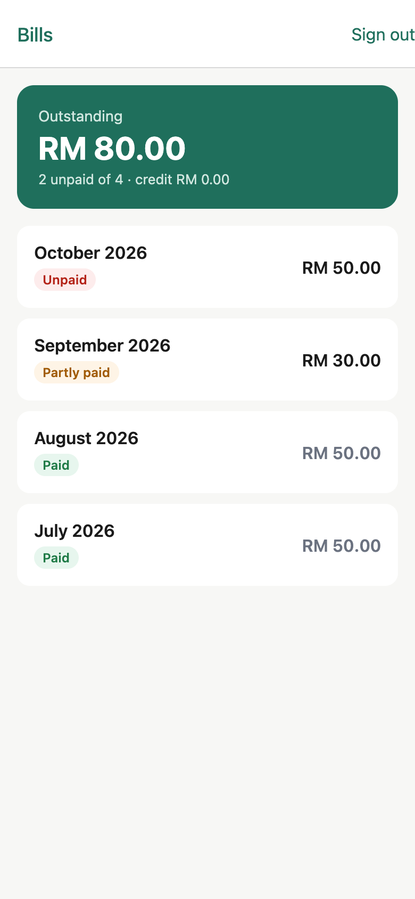
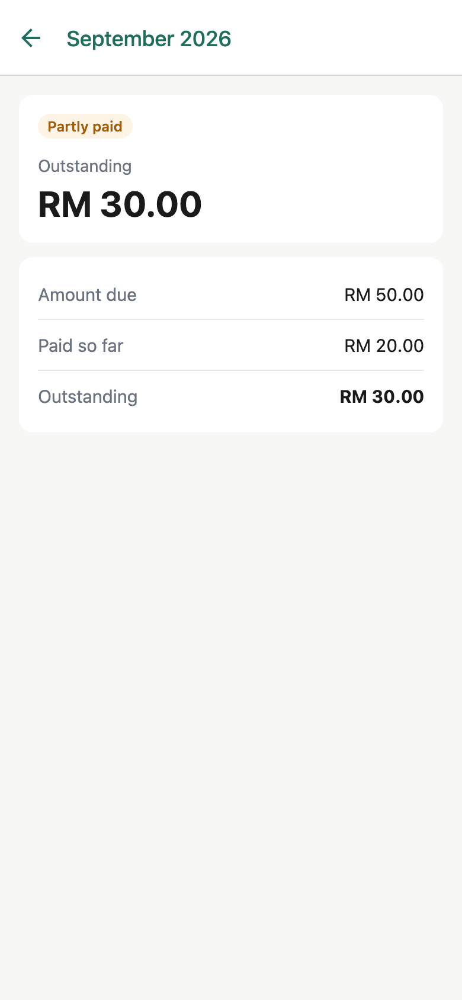

# PENTANA Expo

[](https://github.com/fahmi-dzulqarnain/pentana-expo/actions/workflows/ci.yml)

A React Native (Expo) client for the [PENTANA](https://github.com/fahmi-dzulqarnain/pentana-system) membership API: sign in, see what you owe, and open each monthly bill.

It's a personal project, a companion to the native PENTANA apps (SwiftUI on iOS, Jetpack Compose on Android, sharing logic through Kotlin Multiplatform), built to explore the same product in React Native and TypeScript.

| Sign in | Bills | Bill detail |
|---|---|---|
|  |  |  |

Screenshots are the web build against a local PENTANA API with demo data.

## Features

- **Sign in** with email and password against the Laravel Sanctum API. The token is kept in the Keychain / Android Keystore with `expo-secure-store` (localStorage on web, for local development).
- **Bills list** with the outstanding total, pull to refresh, and loading, empty and error states.
- **Bill detail** with amount due, paid so far and outstanding.
- **Session handling**: any `401` signs the user out and clears cached data; signing out also revokes the token on the server, and still signs out locally if that call fails.

## Stack

| | |
|---|---|
| App | Expo SDK 58 · React Native 0.88 · TypeScript (strict) · React Compiler |
| Navigation | Expo Router, with `Stack.Protected` guarding signed-in screens |
| Data | TanStack Query for fetching, caching and refetching |
| Storage | `expo-secure-store` |
| Tests | Jest (`jest-expo`) · React Native Testing Library |
| CI | GitHub Actions: clean install, typecheck, lint, tests |

## Architecture

Dependencies point inwards: screens and hooks depend on the domain, never on the HTTP client or the API's wire format.

```
src/
  app/                  UI: routes (Expo Router) — login, bills list, bills/[id]
  features/bills/       use-case hooks (useBills, useBill, useBillSummary) and bill UI components
  domain/               models (Bill, BillSummary), Money in integer sen, BillsRepository interface
  data/                 API-backed BillsRepository and DTO -> domain mappers
  di/                   RepositoriesProvider: composition root, swappable in tests
  api/                  fetch client with typed errors and auth headers
  auth/                 AuthProvider (session state) and secure token storage
  components/           shared loading / error / empty states, theme
```

```
app/ screens ─▶ features/ hooks ─▶ domain/ BillsRepository ◀─ data/ apiBillsRepository ─▶ api/ client
```

- **Money is integer sen.** The API sends fixed 2-dp strings; `parseMoney` turns them into sen without going through a float, so `0.10 + 0.20` really is `0.30`.
- **The wire format stops at `data/`.** `toBill` maps `amount_due` and `"2026-09"` into a typed `Bill`; an unknown status from a newer API shows as pending instead of crashing the list.
- **Tests inject a fake repository** through `RepositoriesProvider`, so screen tests exercise real hooks and caching without mocking `fetch`.

## Performance

- **React Compiler** is on (`experiments.reactCompiler`), memoizing components and callbacks automatically; its lint rules run in CI.
- **The list** uses `FlatList` with module-level `keyExtractor`, `renderItem` and separator, so they keep their identity across renders, and `BillRow` is wrapped in `memo`, so a refetch only re-renders rows whose bill changed.
- **No duplicate requests.** The API has no `GET /bills/{id}`, so the detail screen selects the bill from the cached list with TanStack Query's `select`; a test asserts the repository is called once.
- **Caching.** Queries stay fresh for 60 seconds; pull to refresh refetches the list and summary together.

## Testing

37 tests across the layers:

| Layer | What is covered |
|---|---|
| Domain | Money parsing and formatting, including float-drift and invalid input |
| Data | DTO mapping, unknown statuses, unwrapping Laravel's `data` envelope |
| API client | Bearer token, server error messages, sign-out on a `401` only when a token was sent |
| Auth | Restoring a saved session, unreadable storage, sign-in storing and sending the token, `401` sign-out, sign-out when revoke fails |
| Screens | Login validation and errors; bills list, empty, error-and-retry and navigation; bill detail, not-found, and no extra request |

## Run it

```bash
cp .env.example .env    # point EXPO_PUBLIC_API_URL at your PENTANA API
npm install
npx expo start          # then press i (iOS simulator), a (Android), w (web) or scan the QR code with Expo Go
```

## Checks

```bash
npm run typecheck
npm run lint
npm test
```

## Build for Android

```bash
npx eas-cli@latest build --platform android --profile preview
```

The app icons are generated by `scripts/make-icons.py`.
